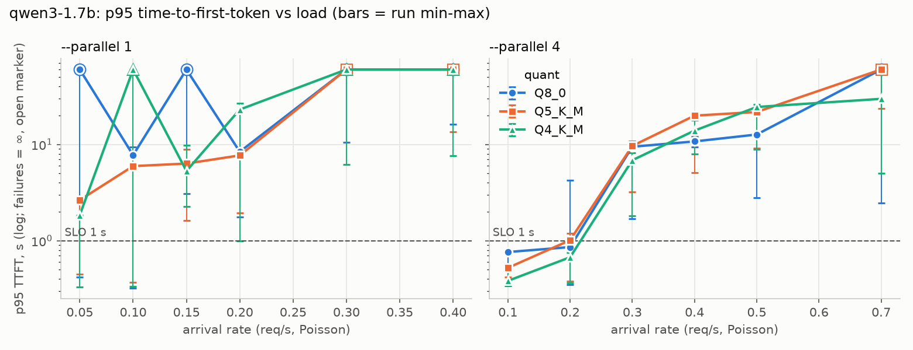

# LocalServe — measured LLM serving on one Apple Silicon laptop

**Problem.** If you serve an open-weight model from a single machine, which quantization and how many
parallel slots give the most throughput *without* breaking a latency target or the model's quality?
Most numbers online are single-request tokens/sec. This repo measures **capacity at a latency SLO**,
always next to a **quality number**, on one specific machine (an 8 GB M2 MacBook Air), with every
number regenerated by script from raw per-request logs.

**Status: MINIMUM scope** (Qwen3-1.7B × {Q8_0, Q5_K_M, Q4_K_M} × `--parallel` {1, 4}). Engineering
work, not research: no novelty claim.

## Method (short)

- **Server:** `llama-server` (llama.cpp, pinned commit, Metal, all layers on GPU, continuous batching,
  2048-token context per slot).
- **Gateway:** an OpenAI-compatible FastAPI proxy in front of it, with SSE streaming, a bounded queue that
  returns 429 when full, cancellation on client disconnect, timeouts, `/metrics`, and JSON logs.
- **Load:** open-loop Poisson arrivals at fixed rates, with synthetic 150-word chat prompts (the
  measured token count is in the generated findings) and exactly 128 output tokens (`ignore_eos`).
  - Each (config, rate) point is 3 runs of 60 s, after 15 s of warm-up.
  - Configs and rates run in interleaved, shuffled order, with a cool-down between points.
- **Capacity:** the highest grid rate where that rate *and every lower one* keeps the pooled
  p95 time-to-first-token (TTFT) ≤ 1.0 s. Rejected, failed and timed-out requests count as infinite TTFT,
  so a server can't pass by dropping slow requests.
- **Quality gate:** KL divergence and same-top-token rate against Q8_0 (`llama-perplexity --kl-divergence`)
  on a wikitext-2 subset.
- **Gateway overhead:** measured, not assumed — a paired A/B on an idle server plus identical open-loop
  load with and without the gateway.

Details are in [docs/REPORT.md](docs/REPORT.md); the run history and failures are in [docs/LOG.md](docs/LOG.md).

## Results

All tables are generated by `scripts/make_report.py` from `results/minimum/summary.json`.

**Table 1 — speed and quality per quant** (llama-bench single stream; KLD vs Q8_0)

<!-- BEGIN:table1 -->
<!-- END:table1 -->

**Table 2 — capacity at the chat SLO, and latency at 70% of capacity**

<!-- BEGIN:table2 -->
<!-- END:table2 -->



**Key numbers (generated)**

<!-- BEGIN:findings -->
<!-- END:findings -->

## Limitations

- **One machine.** An 8 GB fanless M2 that was also running other apps (browser, editor) and swapping.
  Runs that swapped during measurement are counted in the report. Results don't transfer to other Macs,
  GPUs or vLLM.
- **One small model** in this scope, and synthetic prompts (unique per request, so no shared-prefix cache
  hits). No long-prompt class.
- **Capacity is grid-limited:** it's one of the tested rates, not an interpolated value.
- **Small samples at low rates:** 60 s windows give few requests there, so those p95 values are noisy.
- **KLD covers a subset** of wikitext-2 (disk limit on reference logits). It measures distribution drift
  vs Q8_0, not task accuracy; the task check is in the STRONG scope.
- **A benchmark is a measurement of this setup, not a guarantee.** Re-measure on your own hardware.

## Reproduce

```bash
make install            # Python 3.12 via uv, pinned lockfile
make check              # ruff + mypy --strict + offline tests (what CI runs)
make report             # regenerate summary.json, figures and tables from committed raw results
# full re-measurement (hours, macOS + Metal):
make build-llama models quality sweep report
```

Third-party data and weights are downloaded at run time and never committed. The model is Qwen3-1.7B
(Apache-2.0); the KLD text is wikitext-2 (CC BY-SA 3.0).
