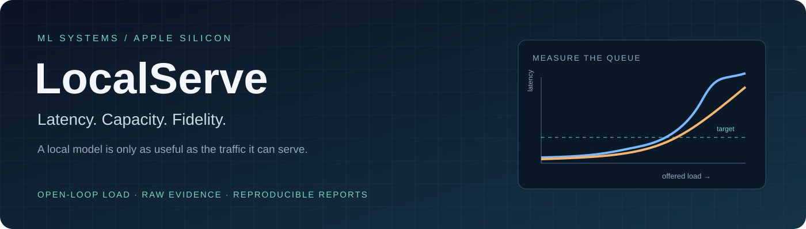
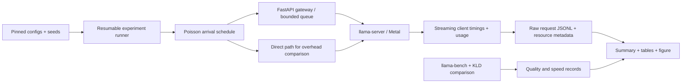

# LocalServe



<p align="center">
  <a href="docs/REPORT.md">Full Report</a> ·
  <a href="results/minimum/tables.md">Measured Results</a> ·
  <a href="docs/OPERATIONS.md">Runbook</a> ·
  <a href="docs/LOG.md">Experiment Log</a>
</p>

<p align="center">
  I measure how quantization and parallel serving change the traffic a local language model<br>
  can handle within a latency target, alongside the quality it gives up.<br>
  <sub>ML systems · open-loop load testing · reproducible measurements</sub>
</p>

<p align="center">
  <code>Python 3.12</code> · <code>FastAPI</code> · <code>llama.cpp + Metal</code> ·
  <code>Qwen3-1.7B</code> · <code>Prometheus</code> · <code>pytest</code>
</p>

[](https://github.com/sakshamg251206/LocalServe/actions/workflows/ci.yml)

## The question

Single-request tokens per second does not tell you how many independent users a model
server can support. Requests arrive while other requests are still generating, queues grow,
and the first token can arrive too late even when generation looks fast.

LocalServe measures **capacity at a latency target**, with a quality measurement beside it.
The complete scoped experiment uses Qwen3-1.7B at Q8_0, Q5_K_M and Q4_K_M, each with
one or four parallel slots, on an **8 GB M2 MacBook Air**.

## The result

<!-- BEGIN:findings -->
- Mean prompt length (server-counted, incl. chat template): 177 tokens; output fixed at 128 tokens.
- `--parallel 4`: highest measured capacity 0.2 req/s (Q8_0).
- Gateway TTFT overhead (idle, paired): 3.87 ms median (95% CI -6.89–9.15 ms); target was < 5 ms.
<!-- END:findings -->


The smallest quantization has the highest single-stream generation speed, but it does
not uniquely win capacity under the latency target. Every single-slot configuration
failed at the lowest tested rate, so its capacity is **below the grid**, not zero.
The gateway overhead interval crosses the target: the median alone does not establish
that the overhead target was met. These are measurements of this laptop and workload.

## What is complete

The **MINIMUM scope is complete**: 108 capacity points, nine follow-up latency runs at
70% of measured capacity, twelve open-loop overhead runs and 100 idle A/B pairs.
Follow-up runs are omitted for configurations whose capacity falls below the tested grid.
All three quantizations have single-stream speed measurements and distribution comparisons;
Q8_0 is also checked against the F16 source.

The repository contains the serving gateway, seeded load generator, resumable experiments,
raw request records, generated tables and figure, pinned dependencies and offline CI.
This is an engineering case study with no new-algorithm claim. Larger models, long-prompt
workloads and task-accuracy evaluations are future extensions.

## Measured results

Generated by `scripts/make_report.py` from the archived raw records in
[`results/minimum/raw/`](results/minimum/raw/). Speed values show mean ± standard deviation;
KLD and same-top-token values show the tool's reported ± standard error.

<details>
<summary><strong>Expand speed, fidelity and serving-capacity tables</strong></summary>

### Speed and fidelity

<!-- BEGIN:table1 -->
| Quant | File size (GB) | Prompt tok/s (pp512) | Gen tok/s (tg128) | Mean KLD vs Q8_0 | Same top token vs Q8_0 (%) | PPL (wikitext-2 subset) |
|---|---|---|---|---|---|---|
| Q8_0 | 2.159 | 738 ± 4 | 46.6 ± 0.2 | 0 (reference) | 100 (reference) | 17.061 |
| Q5_K_M | 1.466 | 599 ± 2 | 54.2 ± 0.2 | 0.0297 ± 0.0005 | 92.58 ± 0.16 | 17.323 |
| Q4_K_M | 1.276 | 663 ± 1 | 67.5 ± 1.3 | 0.1020 ± 0.0016 | 87.13 ± 0.21 | 18.674 |

Reference check — Q8_0 vs the F16 source: mean KLD 0.00147 ± 0.00002, same top token 98.37%.
<!-- END:table1 -->

### Capacity and latency

<!-- BEGIN:table2 -->
| Quant | --parallel | Mean KLD vs Q8_0 | Capacity (req/s @ p95 TTFT ≤ 1 s) | Rate tested at 70% | p95 TTFT @70% (s) | p95 ITL @70% (ms) | Output tok/s @70% | Server footprint peak (GB) | Runs/point |
|---|---|---|---|---|---|---|---|---|---|
| Q8_0 | 1 | 0 (reference) | < lowest rate | – | – | – | – | 3.25 | 3 |
| Q8_0 | 4 | 0 (reference) | 0.2 | 0.140 | 0.36 | 47.3 | 25.6 | 6.83 | 3 |
| Q5_K_M | 1 | 0.0297 ± 0.0005 | < lowest rate | – | – | – | – | 3.23 | 3 |
| Q5_K_M | 4 | 0.0297 ± 0.0005 | 0.1 | 0.070 | 0.40 | 19.5 | 4.3 | 6.83 | 3 |
| Q4_K_M | 1 | 0.1020 ± 0.0016 | < lowest rate | – | – | – | – | 3.69 | 3 |
| Q4_K_M | 4 | 0.1020 ± 0.0016 | 0.2 | 0.140 | 0.36 | 42.3 | 25.6 | 6.95 | 3 |
<!-- END:table2 -->

</details>

**TTFT** is time to the first token. **ITL** is the gap between token-bearing streaming events;
an event can contain more than one token. **KLD** compares the full next-token distribution
with the reference; it is distribution drift, not a task-accuracy score. No quality
pass/fail threshold is defined in this scope.

See the [full report](docs/REPORT.md) for overhead comparisons, uncertainty and data-quality notes.

## How the measurement works

- **Server:** pinned llama.cpp, Metal, all model layers on GPU, continuous batching and
  2048 tokens of context per slot.
- **Gateway:** an OpenAI-compatible FastAPI proxy with SSE streaming, bounded admission,
  queue-full responses, cancellation, deadlines, JSON request logs and Prometheus metrics.
- **Workload:** independent Poisson arrivals, unique synthetic 150-word chat prompts,
  deterministic decoding and exactly 128 requested output tokens with `ignore_eos`.
- **Protocol:** three 60-second repetitions per point after 15 seconds of warm-up;
  shuffled configuration/rate order and a 15-second cooldown. Arrival seeds match across
  configurations for a given rate and repeat.
- **Capacity:** the highest tested rate where that rate **and every lower tested rate**
  keep pooled p95 TTFT at or below 1 second. Rejected, failed and timed-out requests
  receive infinite TTFT, so dropping requests cannot improve the score.
- **Fidelity:** llama-perplexity KLD and same-top-token rate on a wikitext-2 subset,
  using Q8_0 as the quantized reference.
- **Overhead:** alternating direct/gateway idle pairs with a bootstrap interval, plus
  matching open-loop arrival schedules through each path.

Open-loop traffic keeps arriving when the server slows down. A closed-loop test waits
for previous replies and therefore reduces demand under overload, hiding queueing latency.

## Architecture



| Component | Responsibility |
|---|---|
| `src/localserve/gateway/` | Admission control, upstream forwarding, cancellation and metrics |
| `src/localserve/loadgen/` | Seeded arrivals, unique prompts, client timings and failure-aware statistics |
| `src/localserve/capacity.py` | Conservative grid capacity and interval estimators |
| `src/localserve/quality/` | KLD commands and output parsing |
| `src/localserve/report/` | Pool raw requests and aggregate repeated measurements |
| `scripts/` | Build, model setup, quality, sweeps and report generation |
| `configs/` | Pinned source/model revisions, workload and latency target |
| `results/minimum/` | Raw evidence, manifest and generated outputs |

## Reproduce the archived report

Use Python **3.12** and [uv](https://docs.astral.sh/uv/). Initial dependency installation
requires network access. After installation, checks and report regeneration need neither
model weights nor a running model server.

```bash
git clone https://github.com/sakshamg251206/LocalServe.git
cd LocalServe
make install
make check
make report
```

`make check` runs ruff, strict mypy and the offline test suite. Tests cover admission limits,
streaming, cancellation, deadlines, seeded arrivals, failure-aware percentiles, capacity,
quality parsing and reporting. `make integration` separately exercises a real local model.

If the checkout was moved, repair stale environment launchers with
`uv sync --frozen --reinstall` and rebuild llama.cpp before running hardware experiments.

## Run a new experiment

Full remeasurement takes hours and needs macOS, Apple Silicon, CMake, Ninja, build tools,
network access for model/data setup and sufficient disk space for reference logits.
Only one measurement phase should use the GPU at a time.

```bash
make build-llama models
make measure RUN=replication-01
```

The ordered pipeline runs checks, real-model integration, quality, capacity, follow-up
latency, overhead and report generation. Use a **new run ID** for changed settings or a
fresh replication. Repeating an unchanged run ID resumes completed points; changed
recorded configuration is rejected. Per-point failures are logged; inspect the report's
coverage and failure notes rather than treating process exit alone as proof of completeness.

```bash
# Short plumbing checks; these are not benchmark results.
uv run python scripts/run_sweep.py --run-id smoke-local --phase capacity --smoke
uv run python scripts/make_report.py --run-id smoke-local
uv run python scripts/run_sweep.py --run-id smoke-local --phase p70 --smoke
uv run python scripts/run_sweep.py --run-id smoke-local --phase overhead --smoke
uv run python scripts/make_report.py --run-id smoke-local
```

Custom reports remain under `results/<run-id>/`; only `minimum` updates the published
README and report. Capacity is withheld until every configured rate and repeat exists.
For standalone gateway commands, environment variables and failure responses, use the
[operations guide](docs/OPERATIONS.md). The gateway binds to localhost and has no authentication.

## Evidence and limitations

- **One laptop and one model.** Other apps were open; the fanless machine can throttle,
  compress memory and swap. Raw records include memory, thermal and swap metadata.
- **Multiple sessions.** The archive combines the original partial sweep with its later
  continuation. This is not an independent replication; session conditions can differ.
- **Grid-limited estimates.** Below-grid capacity needs lower-rate measurements to locate it.
  Short low-rate windows have few requests, making p95 noisy.
- **Synthetic workload.** Unique prompts reduce shared-prefix reuse. Long prompts, real
  conversations and broad workload robustness remain unmeasured.
- **Quality is a proxy.** KLD on a disk-limited wikitext-2 subset does not establish task accuracy.
- **Uncertainty matters.** Idle overhead intervals cross the target. Open-loop path differences
  can also reflect shared-machine noise and ordering; they do not isolate gateway cost perfectly.
- **Provenance limits.** The archived runs used uncommitted source, and the recorded llama.cpp
  version string is empty. The pinned source commit and model hashes are retained, but there
  is no archived binary hash or full source fingerprint establishing exact execution identity.

A benchmark is a measurement of this setup, not a guarantee. There is no model training
or held-out predictive evaluation here. Future changes motivated by these results need
fresh measurements rather than relabeling this archive as independent validation.

## License and attribution

Project code is [MIT licensed](LICENSE). Downloaded weights and datasets are excluded from
version control. Qwen3-1.7B weights are Apache-2.0; wikitext-2 is CC BY-SA 3.0. Their upstream
terms continue to apply. Source revisions, hashes and dataset attribution are recorded in
[`configs/models.yaml`](configs/models.yaml) and the [run manifest](results/minimum/manifest.json).

---

<p align="center">
  <a href="https://github.com/sakshamg251206">Saksham Garg</a> ·
  <a href="https://portfolio-two-delta-mjayivrs90.vercel.app/">Portfolio</a> ·
  <a href="https://www.linkedin.com/in/saksham-garg-997560319/">LinkedIn</a>
  <br><sub>Research. Quantify. Build. Ship.</sub>
</p>
